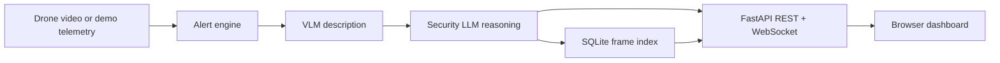

# 🛸 Drone Security Analyst Agent

An AI-powered drone surveillance analysis system that monitors a fixed property 24/7, detects security threats in real-time, and provides an interactive dashboard for security operators.


---

## Features

- **🤖 AI-Powered Analysis** — LangChain agent with Groq's LLaMA 3.3 70B analyzes each drone camera frame for security threats
- **⚡ Real-Time Streaming** — WebSocket-based frame-by-frame analysis streaming to the dashboard
- **🚨 Smart Alerting** — Dual-layer alerting: rule-based pre-filtering + AI-powered risk assessment (Low → Critical)
- **🔍 Queryable History** — SQLite-indexed events searchable by object, time range, or risk level
- **💬 Follow-Up Chat** — Ask the AI agent questions about detected events with conversation memory
- **📊 Daily Summaries** — AI-generated security briefings summarizing the day's activity
- **🎨 Premium Dashboard** — Dark-themed real-time dashboard with animations and responsive design

---

## Architecture

```
┌─────────────────────────────────────────────────────────────┐
│                    SYSTEM ARCHITECTURE                       │
├─────────────────────────────────────────────────────────────┤
│                                                             │
│   📡 Telemetry ──▶ ⚡ Alert Engine ──▶ 🤖 AI Agent        │
│   (15 frames)      (rule-based)         (LangChain+Groq)   │
│                                              │              │
│                                              ▼              │
│                                         🗄️ SQLite           │
│                                         (frames.db)         │
│                                              │              │
│                                              ▼              │
│                                    🚀 FastAPI Server        │
│                                    (REST + WebSocket)       │
│                                              │              │
│                                              ▼              │
│                                    🖥️ Dashboard (HTML/JS)   │
│                                                             │
└─────────────────────────────────────────────────────────────┘
```

See [docs/architecture.md](docs/architecture.md) for detailed architecture diagrams, component descriptions, and technology justifications.

---

## Prerequisites

- **Python 3.10+**
- **Groq API Key** (free) — Get one at [console.groq.com](https://console.groq.com)

---

## Setup & Installation

### 1. Clone the repository
```bash
git clone <repo-url>
cd drone-security-agent
```

### 2. Install dependencies
# Drone Security Analyst Agent

An AI-powered drone surveillance system that watches a fixed property, analyzes frame-by-frame activity, stores results in SQLite, and surfaces security events in a live dashboard. The project is built to demonstrate a complete end-to-end workflow: telemetry simulation, image understanding, rule-based alerting, LLM reasoning, searchable storage, and operator-facing visualization.


## What This Project Does

The system has two operating modes:

1. Demo mode replays 15 predefined surveillance frames from [backend/telemetry.py](backend/telemetry.py) so the full workflow can run without a video file.
2. Video mode extracts frames from a real drone video, runs them through a vision-language model, then sends the image description to an AI security analyst for structured risk assessment.

Each analyzed frame is persisted to SQLite, indexed for search, and shown in the dashboard as a timeline of events and alerts.

## Key Capabilities

- Real-time frame analysis with WebSocket streaming
- Vision-language analysis of extracted video frames
- Rule-based pre-filtering for night activity, loitering, perimeter breach, and unauthorized access
- LLM-based security reasoning with structured JSON output
- SQLite-backed queryable event history
- AI follow-up chat with memory over recent turns
- Daily or video summary generation for operators
- Responsive dashboard with live alerts, event log, and summary modal

## System Overview



The detailed design artifacts live in [docs/architecture.md](docs/architecture.md). The validation plan is in [docs/testing.md](docs/testing.md).

## Artifacts and Demo Links

For workflow and architecture references, see the artifacts folder:

- [docs/artifacts](docs/artifacts)

This folder contains the design artifacts for:

- Workflow explanation and flowcharts
- System architecture diagrams
- Testing and validation artifact documentation

Video demo and PDF report link:

- [Google Drive: Video Demo + PDF Report](https://drive.google.com/drive/folders/1CmXLpb5oajYntBu4j0fKm_WOgxUoShUM?usp=sharing)

## Repository Layout

```text
drone-security-agent/
├── backend/
│   ├── main.py          FastAPI app, REST endpoints, WebSockets, static hosting
│   ├── agent.py         LangChain agent, frame analysis, chat, summaries
│   ├── vlm.py           Groq vision-language frame description pipeline
│   ├── alert_engine.py  Deterministic rule engine and risk floor logic
│   ├── indexer.py       SQLite storage and query helpers
│   ├── telemetry.py     Demo surveillance timeline
│   └── video_processor.py  Frame extraction and video metadata utilities
├── frontend/
│   ├── index.html       Dashboard shell
│   ├── app.js           Browser logic and live updates
│   └── style.css        Visual system and layout
├── docs/
│   ├── architecture.md  System architecture diagrams and rationale
│   └── testing.md       Validation strategy and test scenarios
└── tests/
    └── test_agent.py    Automated test suite
```

## Design Decisions

| Decision | Why it was chosen |
|---|---|
| Groq for model inference | Fast responses and OpenAI-compatible APIs made it suitable for a lightweight assessment project.
| Two-stage AI pipeline | The VLM turns images into text, and the text LLM focuses on reasoning and risk classification. This separation reduces prompt complexity and makes failures easier to isolate.
| Rule engine before LLM | Hard rules enforce minimum risk levels for critical events like perimeter breach and unauthorized access.
| SQLite for persistence | Zero configuration, easy local setup, and enough scale for a single-property prototype.
| WebSockets for streaming | The operator needs frame-by-frame progress feedback instead of waiting for a final batch response.
| Vanilla frontend | No build step, easy static hosting, and simple integration with FastAPI.
| JSON-only analysis output | The backend expects structured fields, which keeps the dashboard, indexing, and testing deterministic.

## AI Tools Integrated Into The System

The project uses multiple AI components, each with a distinct role:

- VLM in [backend/vlm.py](backend/vlm.py) describes image content from extracted frames.
- LLM agent in [backend/agent.py](backend/agent.py) converts those descriptions into a security assessment.
- LangChain coordinates tool calling, memory, and structured interactions.
- Groq provides the model runtime for both vision and text reasoning.

Impact on the workflow:

- The VLM reduces the need to hand-code visual heuristics for every frame type.
- The LLM produces consistent JSON objects for downstream storage and UI rendering.
- The rule engine acts as a guardrail so important threats are not diluted by model variance.
- Memory-backed chat lets the operator ask follow-up questions without resending the full context.

## Setup

### Prerequisites

- Python 3.10 or newer
- A Groq API key
- Optional video files placed in the [videos](videos) directory for real video analysis

### Install Dependencies

From the repository root:

```bash
python -m venv .venv
.venv\Scripts\Activate.ps1
pip install -r backend/requirements.txt
```

If you prefer to reuse an existing environment, install the packages listed in [backend/requirements.txt](backend/requirements.txt).

### Configure Environment

Create a [backend/.env](backend/.env) file with:

```bash
GROQ_API_KEY=your_actual_key_here
```

The system loads environment variables automatically through `python-dotenv`.

## Running The Application

### Start The Backend

```bash
cd backend
python main.py
```

The FastAPI server starts on `http://localhost:8000` and serves both the API and the dashboard.

### Open The Dashboard

Visit `http://localhost:8000` in a browser.

### Demo Mode

Use the demo mode button to replay the 15 predefined telemetry frames. This is the easiest way to verify the full pipeline without needing a video file.

### Video Mode

Place one or more `.mp4`, `.avi`, `.mov`, `.mkv`, or `.webm` files in the [videos](videos) directory, refresh the dashboard, choose a file, and click Analyze Video.

## Runtime Flow

1. The frontend requests `/api/status` and `/api/videos` on load.
2. The operator starts demo mode or selects a video for processing.
3. The backend extracts frames if needed and enriches them with telemetry.
4. The VLM generates a textual scene description from the image.
5. The alert engine adds deterministic flags and a suggested minimum risk level.
6. The security LLM returns a JSON object with objects, summary, risk, alert text, and reasoning.
7. The frame is written to SQLite and streamed back to the dashboard.
8. The operator can filter the log, query history, or ask follow-up questions.

## API Summary

| Method | Endpoint | Purpose |
|---|---|---|
| GET | `/api/status` | Health and model information |
| GET | `/api/videos` | List available input videos |
| GET | `/api/frames` | Return indexed frames |
| POST | `/api/analyze/{frame_id}` | Analyze one demo telemetry frame |
| POST | `/api/run-simulation` | Run the full demo timeline |
| POST | `/api/process-video` | Analyze a selected video file |
| POST | `/api/upload-video` | Upload a new video for processing |
| GET | `/api/query` | Search by object, risk, or time range |
| GET | `/api/summary` | Generate a security summary |
| POST | `/api/chat` | Ask the agent a follow-up question |
| GET | `/api/telemetry` | Inspect the raw demo timeline |
| WS | `/ws/simulation` | Stream demo mode in real time |
| WS | `/ws/process-video` | Stream video analysis in real time |

## Validation And Testing

Run the test suite with:

```bash
pytest tests -v
```

The suite includes deterministic tests for SQLite indexing, query behavior, and rule-based alerts, plus API-backed tests for the VLM, summary generation, and chat flow.

Validation scenarios covered by the project are documented in [docs/testing.md](docs/testing.md). In short, the system is checked against:

- Normal daytime activity
- Night-time loitering
- Unauthorized access attempts
- Repeated vehicle appearance
- Perimeter breach and escalation to Critical
- Empty or low-risk frames
- Dynamic input changes in uploaded or selected videos
- Emergency-style events that should trigger alerts immediately

## Example Output

```json
{
  "detected_objects": ["person", "hoodie", "phone"],
  "event_summary": "A person in a hoodie is loitering near the main gate late at night.",
  "risk_level": "High",
  "alert_message": "ALERT: Person loitering at main gate after hours",
  "reasoning": "Night presence and repeated loitering near a primary entry point require escalation."
}
```

## Limitations

- The demo telemetry is synthetic and is meant to exercise the pipeline, not to model real-world scene complexity.
- The SQLite query layer is intentionally simple and is not a replacement for semantic search at scale.
- The current video pipeline depends on the availability and quality of the chosen drone footage.

## Future Improvements

- Add semantic search with embeddings
- Support multiple cameras and location-aware dashboards
- Add automated notification channels for critical alerts
- Store summaries and trends for historical analytics
- Replace the simulation input with live drone telemetry ingestion

## License

This project was created as part of a technical assessment.
