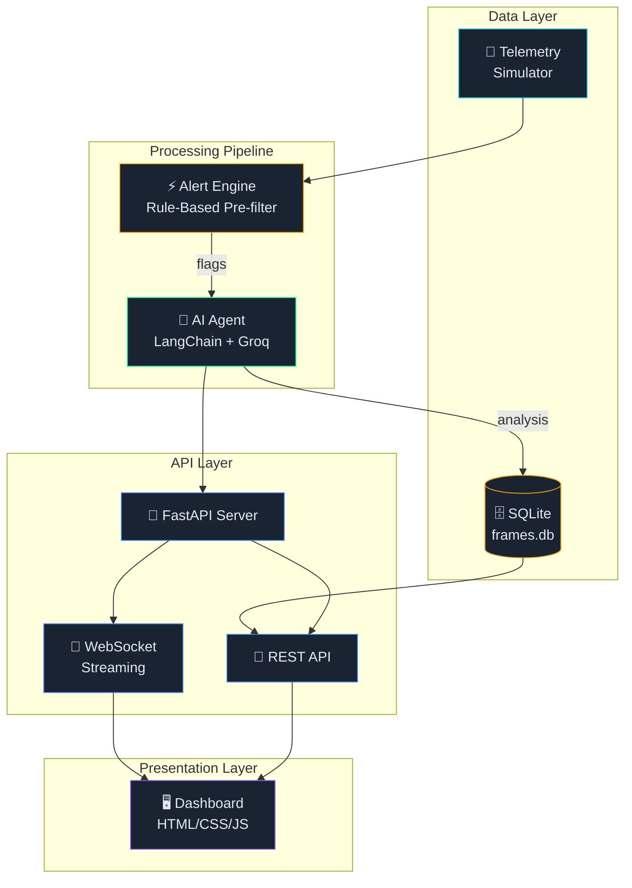
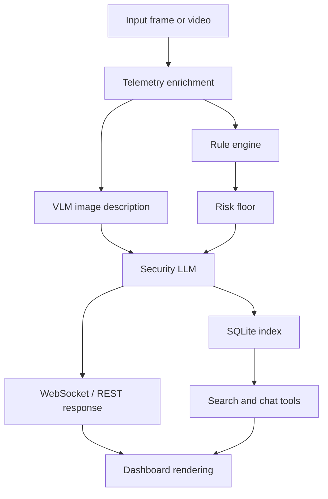
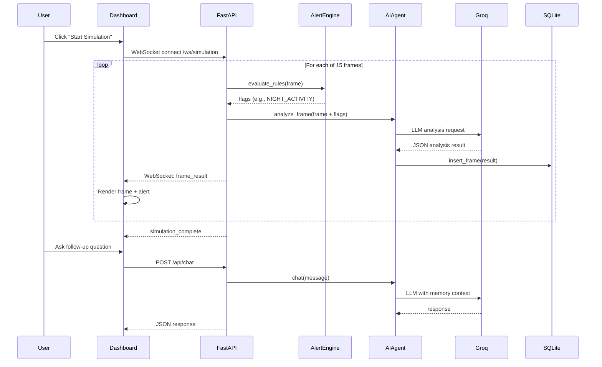

# System Architecture — Drone Security Analyst Agent

## Feature Specification

### Value Proposition
The Drone Security Analyst Agent enhances property security by providing **automated 24/7 drone monitoring** with AI-powered analysis. Property owners get:

- **Automated threat detection** — No need for human operators watching feeds around the clock
- **Intelligent alerting** — AI distinguishes between routine activity and genuine threats
- **Searchable event history** — Query past events by object, time, or severity level
- **Real-time response** — Immediate alerts for critical security events

### Key Requirements
1. **Real-time analysis**: Process drone camera frames and telemetry data in real-time, detecting objects, people, and activities
2. **Indexed event history**: Store every analyzed frame in a queryable database, searchable by object type, timestamp, and risk level
3. **Intelligent alerting**: Generate security alerts based on a combination of rule-based logic and AI reasoning, with severity levels from Low to Critical

## Problem-Solving Approach

The project was structured around a simple but reliable idea: do not ask the LLM to infer everything from raw video and do not let deterministic rules replace reasoning entirely. The implementation separates responsibilities into layers so each layer can fail independently without breaking the others.

The design choices were:

- convert image frames into text first with a VLM
- apply deterministic rules before final risk classification
- persist every final decision in SQLite for retrieval and chat
- stream intermediate states to the dashboard so the operator sees progress

This gives the system a clear audit trail: raw frame -> visual description -> rule flags -> final risk -> indexed record -> dashboard and chat.

---

## System Architecture



### Processing Flow



### Operational Boundaries

- Demo telemetry is deterministic and is used for repeatable validation.
- Uploaded or local video files are treated as untrusted inputs and are processed only after metadata and frame extraction.
- LLM output is never stored directly without parsing and schema enforcement.
- The rule engine can elevate severity, but the LLM cannot lower a rule-imposed minimum.

---

## Data Flow



---

## Component Details

### 1. Telemetry Simulator (`telemetry.py`)
- **Purpose**: Provides 15 pre-defined drone surveillance frames
- **Data**: Each frame includes frame_id, timestamp, location, altitude, GPS coordinates, and camera description
- **Coverage**: 24-hour surveillance window (06:00 Jan 15 → 06:00 Jan 16)
- **Locations**: Main Gate, Garage, Perimeter North, Perimeter East, Parking Lot

### 2. Alert Engine (`alert_engine.py`)
- **Purpose**: Deterministic rule-based pre-filtering before AI analysis
- **Rules**:
  | Rule | Condition | Priority |
  |---|---|---|
  | Night Activity | 22:00-06:00 | High |
  | Perimeter Breach | Climbing/breaching fence | Critical |
  | Repeated Vehicle | Same vehicle >1 visit | Medium |
  | Unauthorized Access | No badge + door access | High |
  | Loitering | Pacing/lingering | Medium |
- **Output**: List of flag strings that enrich the AI prompt

### 3. AI Agent (`agent.py`)
- **Framework**: LangChain with AgentExecutor
- **LLM**: Groq `llama-3.3-70b-versatile` (fast, free-tier available)
- **Tools**:
  1. `analyze_frame` — Processes frame + flags → structured JSON output
  2. `query_events` — Natural language querying over indexed frames
  3. `generate_daily_summary` — Produces 4-5 sentence security briefing
- **Memory**: ConversationBufferWindowMemory (last 10 exchanges) for follow-up context

### 4. Frame Indexer (`indexer.py`)
- **Database**: SQLite (`frames.db`)
- **Schema**: frame_id, timestamp, location, description, detected_objects (JSON), risk_level, alert_message, event_summary
- **Queries**: By object (LIKE), time range (BETWEEN), risk level, or all frames
- **Cross-domain**: Satisfies the frame-by-frame indexing requirement

### 5. FastAPI Server (`main.py`)
- **REST Endpoints**: /api/frames, /api/analyze/{id}, /api/run-simulation, /api/query, /api/summary, /api/chat
- **WebSocket**: /ws/simulation for real-time frame streaming
- **Static Files**: Serves frontend from /static/

### 6. Frontend Dashboard
- **Technology**: Vanilla HTML + CSS + JavaScript
- **Layout**: 4-panel grid (Controls/Alerts | Frame Analysis | Chat | Event Log)
- **Features**: WebSocket streaming, real-time alerts, event filtering, AI chat
- **Theme**: Dark navy (#0a0f1e) with green (#00ff88) and red (#ff4444) accents

### 7. Data Contract

Every analyzed frame is expected to carry the following logical fields:

- identity: frame_id, timestamp, location
- telemetry: altitude, drone_lat, drone_lon
- visual context: description or vlm_description
- outcome: detected_objects, risk_level, alert_message, event_summary
- provenance: image_path, video_source

This contract keeps the frontend, the database, and the chat/query tools aligned.

---

## API Reference

| Method | Endpoint | Description |
|---|---|---|
| GET | `/api/frames` | All indexed frames |
| POST | `/api/analyze/{frame_id}` | Analyze specific frame |
| POST | `/api/run-simulation` | Run full simulation |
| GET | `/api/query?object=truck` | Query by detected object |
| GET | `/api/query?risk=Critical` | Query by risk level |
| GET | `/api/query?start=...&end=...` | Query by time range |
| GET | `/api/summary` | Generate daily summary |
| POST | `/api/chat` | Chat with AI agent |
| GET | `/api/status` | System status |
| GET | `/api/telemetry` | Raw telemetry data |
| WS | `/ws/simulation` | Real-time streaming |

---

## Security Alert Classification

```
┌──────────────────────────────────────────────────────────┐
│                    RISK LEVEL MATRIX                      │
├──────────┬───────────────────────────────────────────────┤
│ CRITICAL │ Perimeter breach, fence climbing              │
│          │ Unauthorized access at night                  │
├──────────┼───────────────────────────────────────────────┤
│ HIGH     │ Night-time loitering                          │
│          │ Door access attempts without badge            │
│          │ Person present 22:00-06:00                    │
├──────────┼───────────────────────────────────────────────┤
│ MEDIUM   │ Person near perimeter fence                   │
│          │ Repeated vehicle entry (>1/day)               │
│          │ Loitering during daytime                      │
├──────────┼───────────────────────────────────────────────┤
│ LOW      │ Normal activity, routine patrol               │
│          │ Authorized vehicles, badge-holders            │
│          │ Empty areas, no activity                      │
└──────────┴───────────────────────────────────────────────┘
```

---

## Technology Justification

| Choice | Reasoning |
|---|---|
| **Groq + LLaMA 3.3** | Free API tier, extremely fast inference (~200 tokens/sec), OpenAI-compatible |
| **LangChain** | Industry-standard agent framework with tool calling, memory, and Groq integration |
| **SQLite** | Zero-configuration, built into Python, perfect for prototype-scale indexing |
| **FastAPI** | Async support, WebSocket built-in, automatic API docs, type validation |
| **Vanilla JS** | No build step, no dependencies, instant deployment, easy to modify |

---

## Emergency Response Logic

The system treats the following as emergency-style events:

- perimeter fence climbing or breach
- unauthorized access attempts at night
- repeated suspicious presence near primary entry points at night

When one of these conditions is triggered, the output is expected to escalate to High or Critical, and the dashboard highlights the event immediately. The design intentionally prioritizes fast operator visibility over sophisticated post-processing.

## Summary of Artifacts

- [README.md](../README.md) for setup and project overview
- This file for architecture, design rationale, and component relationships
- [testing.md](testing.md) for validation strategy and test scenarios
